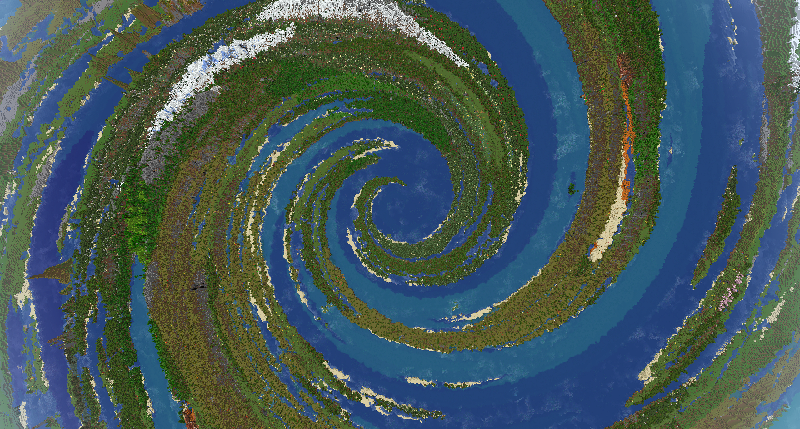

# Spiral World

Fabric Mod that makes Minecraft generate spiral worlds.

## Download

The compiled mod can be downloaded from the [releases tab](https://github.com/oskar2517/spiral-worlds/releases). Currently, only Minecraft 26.3 is supported. 

I recommend using the mod with an LOD terrain mod such as [Distant Horizons](https://modrinth.com/mod/distanthorizons) for the best effect.

## How this mod works

Minecraft generates random terrain by sampling and combining multiple noise functions for each coordinate in the world. Some of them decide the shape of the land (continents, oceans, mountains, valleys, etc.) while others select properties such as temperature/biome.

This mod changes how some of these noise functions are sampled. Before looking up a position, it rotates that position around the world origin (0, 0) by an angle that grows with the distance from it. Points close to the center get twisted more tightly and points far away more gently. This results in the spiral pattern shown below.

The actual logic of this mod is extremely simple and entirely contained within [SpiralNoise.java](https://github.com/oskar2517/spiral-worlds/blob/main/src/main/java/me/oskar/spiralworld/SpiralNoise.java), which wraps another noise and overrides the methods for sampling it in 2D and 3D space.

## Screenshots

